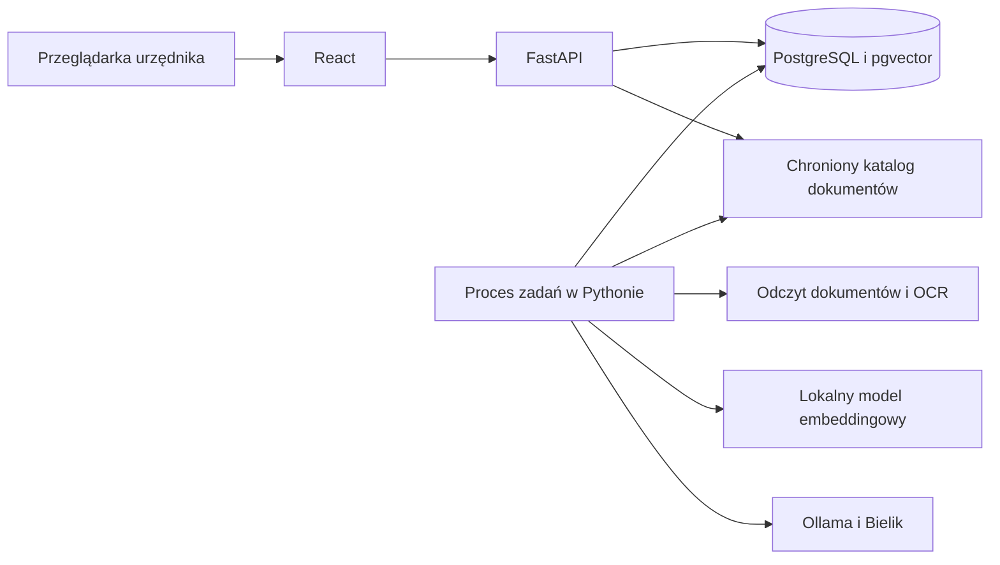

# Inteligentny Asystent Urzędnika

Specyfikacja funkcjonalna i techniczna projektu dla Urzędu Miasta Bydgoszczy w ramach HackNation 2026. Dokument stanowi wzorzec implementacji: określa funkcje, zachowanie systemu, podział modułów, dane, API i kryteria odbioru.

**Stan realizacji:** uruchamialny lokalny prototyp 0.1. Poniższa specyfikacja opisuje zakres docelowy; część rozwiązań pierwszej wersji jest uproszczona. Faktyczny zakres i ograniczenia są opisane w [stanie implementacji](docs/STATUS_IMPLEMENTACJI.md), a instalacja w [instrukcji uruchomienia](docs/URUCHOMIENIE.md).

Uruchomiony podgląd deweloperski: [http://localhost:5173/](http://localhost:5173/). Pierwsze konto i losowe hasło tworzy skrypt bootstrap; lokalne dane logowania znajdują się w ignorowanym pliku `.data/bootstrap-credentials.json`. W repozytorium nie ma stałego hasła administratora.

Zweryfikowano kompilację interfejsu, testy backendu, generowanie odpowiedzi przez lokalny model na danych syntetycznych, wyszukiwanie hybrydowe i konwersję przykładowych materiałów UMB. Pełny odbiór wszystkich kryteriów specyfikacji i próba po fizycznym odłączeniu Internetu pozostają osobnymi krokami.

Aplikacja webowa prowadzi pracownika przez obsługę wniosku o udostępnienie informacji publicznej: rejestrację, analizę, wyszukanie podobnych spraw, zebranie materiałów, przygotowanie pisma, anonimizację i eksport. Projekt odpowiedzi wskazuje źródła oraz braki wymagające uzupełnienia. Urzędnik zatwierdza dane, treść pisma i zakres anonimizacji.

## Podstawa specyfikacji i zgodność z zadaniem

Obowiązkowy zakres wynika z pełnego opisu wyzwania [M1], a warunki konkursowe z regulaminu zadania [M6]. Wybór React, Pythona, PostgreSQL, Ollama i konkretnego modelu jest decyzją implementacyjną: organizator nie narzuca tych technologii. PDF oraz trwała anonimizacja załączników są rozszerzeniem zakresu przyjętym do pierwszej wersji projektu.

| Zapis dokumentacji | Realizacja i dowód odbioru |
|---|---|
| Ręczne wgrywanie PDF/Word, s. 2–3 | Import z podglądem, korektą odczytu i potwierdzeniem danych; test na nowym pliku |
| Rejestr z kalendarzem, kolejnością od najstarszych i 10 wnioskami, s. 2 i 5 | Lista, widok miesiąca, wybór roku, terminy i statusy; demonstracja 10 spraw |
| Podobne sprawy i wskazanie jednostek, s. 2–3 | Lokalne wyszukiwanie archiwum i katalog kompetencji; zatwierdzenie jednostki przez operatora |
| Projekt odpowiedzi na podstawie wgranych materiałów wydziałów, s. 2–3 | Generowanie ze źródłami, edycja i kontrola kompletności |
| Propozycje anonimizacji, akceptacja i ręczne zaznaczenie, s. 2–3 | Zatwierdzanie zakresów tekstu i obszarów stron; sprawdzenie pobranego pliku |
| Eksport DOC/TXT, s. 3 | TXT jako format wymagany wprost; dodatkowo DOCX i PDF; starszy DOC wytwarzany przez konwersję |
| Brak automatycznej wysyłki i integracji z SIDAS, s. 3 | Brak modułu wysyłki; operator ręcznie odnotowuje czynności wykonane poza aplikacją |
| Docelowo lokalnie bez Internetu; zewnętrzne AI dopuszczone na hackathonie, s. 2 i 5 | Wybrany wariant działa lokalnie już w prototypie; test pełnej ścieżki po restarcie bez Internetu |
| Aktualizacja ustaw i archiwum, s. 3 i 6 | Import, zatwierdzenie, wersjonowanie i ponowne indeksowanie źródeł |
| Film do 3 minut, do 10 slajdów, s. 4–5 | Osobne materiały zgłoszeniowe z demonstracją i wskazaniem lokalnego modelu |
| Składniki zewnętrzne i prawa do rozwiązania, regulamin § 3–4 | Wykaz komponentów i licencji, kod oraz dokumentacja do przekazania |

Dokumentacja [M1, s. 6] opisuje testowanie funkcjonalne: jury wgrywa plik, sprawdza podobne sprawy, generowanie pisma z materiałów wydziałów, anonimizację, kalendarz, obsługę i aktualizację wiedzy. Nie określa sprzętu jury, systemu operacyjnego, dostępności GPU, dostarczonego serwera modeli, sposobu instalacji ani wymaganej liczby jednoczesnych użytkowników. Przenośny pakiet i stanowisko zespołu są naszym sposobem przygotowania do oceny, a nie potwierdzonym wymogiem organizatora.

Na s. 5 występuje niejednoznaczny zapis o działaniu „bez dostępu do Internetu i dużych modeli językowych”, połączony z prośbą o wskazanie konkretnego modelu do zamkniętego środowiska. W zestawieniu z s. 2 i dalszym wymaganiem lokalności przyjmujemy lokalny model bez usług zewnętrznych. To interpretacja implementacyjna; ewentualne odmienne wyjaśnienie organizatora wymaga aktualizacji tego jednego założenia przed odbiorem.

## Cel projektu i użytkownicy

Głównym użytkownikiem jest pracownik koordynujący obsługę wniosków UDIP, w szczególności Administrator Informacji Publicznej (AIP) i upoważnieni pracownicy Biura Komunikacji Społecznej.

Zarządzenie nr 535/2024 przewiduje rejestrację i koordynację przez AIP oraz przygotowanie materiałów przez właściwe wydziały. Aplikacja odwzoruje ten podział: koordynator prowadzi sprawę, a odpowiedzi wydziałów wgrywa jako dokumenty. W prototypie nie potrzebujemy osobnego portalu dla każdego wydziału. [M2, § 9–12]

Korzyści będziemy mierzyć czasem przygotowania projektu odpowiedzi, liczbą pytań z przypisanym źródłem oraz liczbą wykrytych braków i błędów. Nie deklarujemy procentowej oszczędności czasu przed przeprowadzeniem pomiarów.

## Zakres funkcjonalny i kryteria odbioru

Priorytetem P0 jest działający pełny przebieg sprawy zgodny z opisem wyzwania. P1 oznacza rozszerzenia po uruchomieniu tego przebiegu.

| Priorytet | Funkcjonalność | Sposób implementacji | Warunek odbioru |
|---|---|---|---|
| P0 | Import PDF i Word | Ekstrakcja tekstu, OCR skanów, podgląd dokumentu i korekta odczytu | Można wprowadzić również odręczny wniosek po ręcznym potwierdzeniu treści |
| P0 | Rejestr i kalendarz | Tabela zgodna z XLSX, widok miesiąca, filtry, statusy i oznaczenia terminów | Widocznych 10 spraw testowych, sortowanie od najstarszych i wybór roku |
| P0 | Podobne sprawy | Wyszukiwanie tekstowe i znaczeniowe w lokalnym archiwum | Wniosek o uczniów odnajduje sprawę o uczniach, a nie tylko ten sam wyraz w stopce |
| P0 | Podpowiedź jednostek | Katalog kompetencji, archiwalne przypisania i uzasadnienie propozycji | Użytkownik może zaakceptować kilka jednostek albo wskazać inną |
| P0 | Zebranie odpowiedzi | Ręczny import materiałów przypisanych do sprawy, jednostki i pytań | Widoczne pytania bez odpowiedzi i brakujące załączniki |
| P0 | Projekt pisma | Lokalny model, zatwierdzone fakty, szablon pisma i źródła przy fragmentach | Można wygenerować i edytować projekt; brak danych nie jest uzupełniany domysłem |
| P0 | Anonimizacja | Reguły, polski model językowy do rozpoznawania nazw oraz ręczne zaznaczenia | Operator akceptuje lub odrzuca propozycje; eksport usuwa zatwierdzone dane |
| P0 | Eksport i historia | DOCX/TXT/PDF, konwersja DOC, historia wersji i ręczne odnotowanie wysyłki | Pobrany dokument odpowiada zatwierdzonej wersji; eksport nie oznacza wysyłki |
| P0 | Baza wiedzy | Import ustaw, procedur i archiwum z wersjonowaniem | Nowy dokument staje się dostępny po zatwierdzeniu i indeksowaniu |
| P0 | Anonimizacja załączników i skanów | Propozycje OCR, ręczne obszary i nowy PDF z trwale usuniętymi pikselami | Brak danych pod maską, pierwotnej warstwy tekstowej i oryginalnych obiektów w eksporcie |
| P1 | Rozszerzenia organizacyjne | Statystyki, bardziej szczegółowe role, zaawansowane raporty | Powstają po zamknięciu kryteriów P0 |

Brak automatycznej wysyłki do wydziałów i wnioskodawców oraz brak integracji z SIDAS są świadomymi założeniami wynikającymi z wyzwania. [M1, s. 2–6]

## Stos technologiczny

Poniższe komponenty definiują bazową architekturę implementacji.

| Warstwa | Wybrana technologia | Zastosowanie i uzasadnienie |
|---|---|---|
| Interfejs | React + TypeScript + Vite | Formularze, rejestr, szczegóły sprawy i edytor w jednej aplikacji webowej [T1] |
| Wygląd | Tailwind CSS, lokalne komponenty | Spójne formularze, stany błędów i układ bez zależności od usług chmurowych |
| Tabela i pobieranie danych | TanStack Table, TanStack Query | Sortowanie, filtrowanie, paginacja i odświeżanie stanu z backendu |
| Edycja i przegląd | Tiptap Core/StarterKit; podgląd stron jako obrazy z warstwą zaznaczeń | Edycja pisma oraz zaznaczanie prostokątów na stronach PDF, bez zewnętrznego serwisu przetwarzania [T2] |
| Backend | Python 3.12 + FastAPI + Pydantic | REST API, walidacja struktur odpowiedzi AI oraz dostęp do bibliotek dokumentowych [T3] |
| Dane | PostgreSQL 16 + pgvector, SQLAlchemy, Alembic | Sprawy, historia, zadania przetwarzania i wektory w jednej bazie [T4] |
| Lokalny model | Ollama + Bielik-4.5B-v3.0-Instruct-GGUF, wariant Q8_0 | Analiza i redagowanie po polsku; wariant dostępny w repozytorium autorów, wagi i konfiguracja zapisane lokalnie [T5, T6] |
| Wyszukiwanie znaczeniowe | Sentence Transformers + `intfloat/multilingual-e5-base` | Lokalne wektory dokumentów i zapytań [T7] |
| PDF i OCR | pypdf, pypdfium2, Tesseract z pakietem `pol`, Pillow, ReportLab | Odczyt, renderowanie, OCR z położeniem słów, trwałe maskowanie pikseli i budowa nowego PDF [T8, T11] |
| Word i Excel | python-docx, openpyxl; LibreOffice dla starszego DOC | Odczyt DOCX/XLSX, generowanie czystego DOCX i konwersja DOC w izolowanym procesie |
| Rozpoznawanie danych | spaCy `pl_core_news_lg` + własne reguły | Kandydaci do anonimizacji nazw, identyfikatorów i danych kontaktowych [T9] |
| Uruchamianie | Docker Compose; Ollama natywnie na macOS | Powtarzalne uruchomienie usług; lokalny model może korzystać ze sprzętu hosta |
| Weryfikacja | pytest, Vitest, Playwright | Testy logiki, interfejsu i całego przebiegu sprawy |

Wersje bibliotek, rewizje modeli i sumy kontrolne plików zostaną przypięte w plikach zależności oraz manifeście instalacyjnym podczas przygotowania uruchamialnego pakietu. Bielik 4.5B v3 Q8_0 jest uruchomionym kandydatem bazowym; ostateczny wybór modelu wymaga porównania jakości na zestawie UMB. Większy model nie jest zależnością pierwszej wersji. Wydajność i jakość wymagają pomiaru na sprzęcie zespołu i nie są potwierdzone samym wyborem modelu.

Nie zakładamy treningu własnego modelu, osobnej bazy wektorowej ani rozbudowanego systemu agentów. Zakres realizujemy przez kontrolowane wywołania modelu i zwykłą logikę aplikacji.

## Architektura systemu

Jedna aplikacja frontendowa, jeden backend podzielony na moduły, osobny proces przetwarzania dokumentów oraz lokalne usługi danych i AI.



Długie operacje, np. OCR i generowanie pisma, trafiają do tabeli `processing_jobs`. Proces roboczy pobiera zadanie transakcyjnie, zapisuje postęp, błędy i wynik. Zadania mają identyfikator deduplikacji, limit ponowień oraz czas ważności blokady, aby można je było odzyskać po restarcie. Interfejs odczytuje postęp przez API. W prototypie wystarczy jeden proces roboczy.

LLM nie otrzymuje dostępu do bazy, systemu plików ani narzędzi wykonujących akcje. Backend przekazuje mu wyłącznie wybrane fragmenty i odbiera ustrukturyzowany wynik. Sprawy, zatwierdzenia i terminy są zapisywane przez logikę backendu.

## Interfejs użytkownika

Interfejs obejmuje pięć głównych widoków oraz przegląd załączników otwierany ze szczegółów sprawy.

| Widok | Zawartość | Najważniejsza czynność |
|---|---|---|
| Rejestr i kalendarz | Tabela spraw, miesiąc, filtry roku/statusu/osoby, oznaczenia terminów | Wybranie sprawy wymagającej działania |
| Nowy wniosek | Import, podgląd źródła, odczytane dane, ostrzeżenia i pytania | Potwierdzenie treści i daty wpływu |
| Szczegóły sprawy | Oś zdarzeń, podobne sprawy, jednostki, pytania, materiały i terminy | Zebranie informacji potrzebnych do odpowiedzi |
| Projekt odpowiedzi | Edytor ze źródłami, propozycjami anonimizacji i historią wersji | Sprawdzenie i zatwierdzenie pisma |
| Baza wiedzy | Dokumenty wiedzy, ich wersje i katalog jednostek | Aktualizacja źródeł |

Przegląd załącznika pokazuje miniatury i stronę dokumentu z możliwością przybliżenia, zaakceptowania propozycji OCR oraz dodania prostokątnego obszaru usunięcia, np. podpisu. Każda strona wymaga oznaczenia jako sprawdzona, również jeśli nie zawiera usunięć. Po przetworzeniu użytkownik ogląda wynikowy PDF przed zatwierdzeniem załącznika.

W widoku pisma zastosujemy układ: po lewej pytania i dokumenty źródłowe, pośrodku projekt, po prawej propozycje anonimizacji i lista braków. Na mniejszym ekranie panele będą przełączane zakładkami. Statusy otrzymają etykiety tekstowe, nie tylko kolory; podstawowe operacje muszą działać klawiaturą.

## Przebieg obsługi sprawy

1. Urzędnik wgrywa wniosek i podaje datę wpływu, jeżeli dokument nie pozwala jej jednoznacznie ustalić.
2. System odczytuje treść i proponuje temat, sygnaturę, pytania, okres objęty żądaniem oraz żądaną formę udostępnienia.
3. Urzędnik poprawia i zatwierdza dane. Sprawa pojawia się w rejestrze i kalendarzu.
4. System pokazuje podobne sprawy oraz proponowane jednostki z uzasadnieniem.
5. Urzędnik poza aplikacją występuje o materiały, a w aplikacji odnotowuje tę czynność i terminy wewnętrzne.
6. Po otrzymaniu dokumentów wgrywa je do sprawy i przypisuje do jednostek oraz pytań.
7. System wskazuje pokrycie pytań, braki załączników i ewentualne sprzeczności. Tworzy projekt odpowiedzi z odwołaniami do materiałów.
8. Urzędnik edytuje pismo, zatwierdza anonimizację tekstu oraz wybranych załączników i skanów; sprawdza wynikowe pliki. Akceptacja dotyczy konkretnych wersji pisma i załączników.
9. Pobiera odpowiedź. Po rzeczywistej wysyłce poza aplikacją ręcznie wpisuje datę i sposób udostępnienia.

## Import dokumentów i OCR

Import będzie wieloetapowy, z możliwością poprawienia wyniku przed użyciem w dalszych krokach.

Backend sprawdzi rozszerzenie i rzeczywisty typ pliku, limit rozmiaru, liczbę stron oraz możliwość odczytu. Zapisze oryginał poza katalogiem publicznym pod losowym identyfikatorem i policzy SHA-256. Pliki DOCM i aktywne makra nie będą obsługiwane; konwersja DOC będzie działała bez sieci, z limitami zasobów.

PDF z tekstem odczytamy przez pypdf. Dla każdej strony bez użytecznej warstwy tekstowej uruchomimy renderowanie i Tesseract. DOCX odczytamy wraz z tabelami; jawnie oznaczymy elementy, których parser nie potrafi zinterpretować. Nie będziemy obiecywać bezbłędnego OCR pisma ręcznego. Dla `16.2026` zapewnimy ręczną transkrypcję na podstawie obrazu, bez zewnętrznego OCR.

Każdy fragment zachowa identyfikator dokumentu, numer strony lub akapitu, oryginalny tekst oraz wersję tekstu poprawioną przez użytkownika. OCR zapisuje położenia słów w obrazie strony. Podgląd i eksport używają wspólnego układu współrzędnych po uwzględnieniu obrotu i kadrowania. Korekta transkrypcji nie tworzy automatycznie wiarygodnego położenia słów — brakujące obszary operator zaznacza ręcznie. Powtórny import tego samego pliku nie utworzy niekontrolowanych duplikatów. Renderowanie PDFium odbywa się w wydzielonym procesie, bez równoczesnych wywołań z wielu wątków. [T11]

## Rejestr spraw, kalendarz i terminy

Przejmiemy dziewięć kolumn ze wzoru: Lp., numer sprawy, wnioskodawca, przedmiot zapytania, data wpływu, termin odpowiedzi, data odpowiedzi, osoba odpowiedzialna i pozostało dni. Dodamy status, przypisane jednostki, termin pierwotny, bieżący termin zatwierdzony oraz historię jego zmian. [M3]

Domyślna lista będzie uporządkowana po dacie wpływu rosnąco. Dodatkowy widok „Pilne” posortuje sprawy po bieżącym terminie. Rok sprawy będzie osobnym filtrem; przełom roku nie może ukrywać zaległych spraw w widoku pilnym.

Oznaczenia terminów: po terminie, termin dzisiaj, termin jutro, termin później, zakończona, data do weryfikacji. „Pozostało dni” wyliczamy na serwerze względem daty w strefie `Europe/Warsaw`; zakończone sprawy otrzymają informację o terminowości, zamiast stałego zera.

Silnik terminów będzie niezależną funkcją backendu. Punktem wyjścia jest 14 dni i warunki przedłużenia wynikające z art. 13 UDIP. Dwa miesiące liczymy jako miesiące kalendarzowe, nie jako 60 dni. Reguły dotyczące dnia początkowego, sobót i świąt wymagają potwierdzenia z mentorem prawnym; zapiszemy je jako wersjonowaną politykę i obejmiemy testami granicznymi. [P1]

Zmiana statusu na „kwerenda” lub „doprecyzowanie” nie zatrzymuje zegara. Rejestr zmiany terminu obejmie przyczynę, podstawę, nową datę, osobę zatwierdzającą i potwierdzenie faktycznego powiadomienia poza aplikacją. Terminy wewnętrzne dla wydziałów będą oddzielone od terminu odpowiedzi wnioskodawcy.

## Statusy spraw i rodzaje pism

Oddzielimy etap pracy, sytuację terminu i rodzaj odpowiedzi.

Etapy: `do_weryfikacji`, `zarejestrowany`, `oczekuje_na_materialy`, `projekt_odpowiedzi`, `do_akceptacji`, `gotowy_do_eksportu`, `zakonczony`. Dodatkowe zdarzenia, np. doprecyzowanie i kwerenda, zapisujemy na osi sprawy. Stan po terminie jest wyliczany niezależnie od etapu.

Rodzaj odpowiedzi: udostępnienie informacji, wskazanie dokładnego źródła publicznego, informacja o nieposiadaniu danych, wezwanie do doprecyzowania, zawiadomienie o przedłużeniu, propozycja innej formy udostępnienia albo sprawa wymagająca decyzji administracyjnej.

System może zasugerować rodzaj pisma; użytkownik go potwierdza. Odmowa i inne przypadki wymagające oceny prawnej trafiają do upoważnionej osoby. Nie sprowadzamy ich do automatycznej odpowiedzi wygenerowanej przez model. [M2, § 11–12; P1, art. 14–16]

## Wyszukiwanie podobnych spraw

Zastosujemy wyszukiwanie hybrydowe, łączące dokładne dopasowania i podobieństwo znaczenia.

Dokumenty podzielimy według pytań, akapitów i stron na fragmenty mieszczące się w limicie modelu embeddingowego. Dla E5 zastosujemy prefiksy `query:` i `passage:` oraz wektory 768-wymiarowe. Fragmenty będą miały początkowo około 300–400 tokenów z niewielkim nakładaniem, z kontrolą tokenizacji przed indeksowaniem. [T7]

PostgreSQL zapewni wyszukiwanie tekstowe (`simple`) i dokładne dopasowanie sygnatur, numerów umów oraz lat. pgvector obsłuży odległość cosinusową. Wyniki połączymy metodą Reciprocal Rank Fusion i pogrupujemy według spraw, aby kilka stron jednego pisma nie zajęło całej listy. Dla niewielkiego archiwum wystarczy dokładne przeszukiwanie wektorów; indeks HNSW dodamy po pomiarze potrzeby. [T4]

Domyślnie wyszukujemy w okresie 12 miesięcy bezpośrednio poprzedzających datę wpływu analizowanego wniosku, z widocznym przełącznikiem „Całe archiwum”. To ważne dla pary `599.2026` i `307.2025`: starsza sprawa jest tematycznie odpowiednia, ale wypada poza takie domyślne okno. Okno 12 miesięcy jest przyjętą interpretacją określenia „ostatni rok”; zakres dat jest jawnie pokazany i możliwy do zmiany przez operatora.

Każdy wynik pokaże sygnaturę, datę, temat, jednostkę, fragment dopasowania i powód podobieństwa. Wynik rankingu nie będzie przedstawiany jako procent pewności prawnej. Archiwalna odpowiedź dostarcza kontekstu i wzoru, ale nie dowodzi aktualności liczb.

## Dobór wydziałów i jednostek

Przygotujemy lokalny katalog jednostek z opisem kompetencji, aliasami, źródłem i datą weryfikacji. Dopasowanie połączy podobne sprawy, wyszukiwanie w katalogu oraz analizę poszczególnych pytań.

Materiały wskazują użyteczne przykłady: edukacja — Wydział Edukacji i Sportu; opłaty odpadowe — Wydział Gospodarki Odpadami; inwestycja Astoria — Wydział Inwestycji Miasta; sprawa zwierząt — Wydział Zieleni i Gospodarki Komunalnej oraz schronisko. W sprawach `15.2026` i `17.2026` odpowiedzi wskazują podmioty spoza wewnętrznej struktury urzędu. To przykłady historyczne wymagające sprawdzenia aktualnych kompetencji. [M4]

Model będzie wybierał wyłącznie identyfikatory z katalogu. Backend odrzuci wymyśloną jednostkę. Użytkownik zobaczy uzasadnienie, np. kompetencję i podobną sprawę, i będzie mógł przypisać kilka jednostek. Gdy brak dobrego dopasowania, aplikacja pokaże „Wymaga wskazania jednostki”. Katalog będzie uwzględniał następców zlikwidowanych wydziałów i jednostki zewnętrzne. [M2, § 11 ust. 3–4; P2]

## Generowanie projektu odpowiedzi

Generowanie rozdzielimy na analizę pytań, zebranie dowodów i redakcję pisma.

Najpierw model zwróci listę pytań i żądanych dokumentów w JSON zgodnym ze schematem Pydantic. Dla każdego pytania system zgromadzi zatwierdzone fragmenty bieżących materiałów. Następnie model zaproponuje odpowiedź z identyfikatorami źródeł, listą braków oraz informacją o możliwych sprzecznościach. Użyjemy strukturalnych odpowiedzi Ollama i walidacji po stronie backendu. [T5]

Treść pisma powstanie z zatwierdzonych bloków i szablonu obejmującego sygnaturę, datę, adresata, odpowiedzi punkt po punkcie, załączniki oraz miejsce na podpis. Źródła pozostają widoczne w interfejsie weryfikacyjnym; nie muszą trafiać do pisma zewnętrznego w postaci technicznych identyfikatorów.

Backend sprawdzi istnienie wskazanych źródeł, ich dostępność dla użytkownika, powiązanie ze sprawą, daty i zgodność cytowanych liczb. Samo istnienie cytowania nie dowodzi poprawności wniosku modelu — urzędnik ma możliwość otwarcia fragmentu i potwierdzenia jego znaczenia.

Brak załącznika lub faktu tworzy pole do uzupełnienia i blokadę zatwierdzenia jako kompletnej odpowiedzi. Można zapisać niekompletny szkic albo wybrać odpowiedni typ pisma proceduralnego. Model nie ma dopowiadać liczby uczniów na podstawie samego listu przewodniego `307.2025` ani uznawać planowanego budżetu za faktycznie poniesiony koszt.

## Kontrola kompletności odpowiedzi

Każde pytanie z wniosku otrzyma własny rekord i stan: brak materiału, materiał do sprawdzenia, odpowiedź przygotowana, odpowiedź zatwierdzona lub świadomie obsłużona innym rodzajem pisma.

Tabela „Pytanie — odpowiedź — źródło — załącznik — stan” będzie centralnym elementem sprawy. Wniosek może wymagać dokumentu, tabeli, konkretnego okresu lub wskazanej formy udostępnienia. System porówna te wymagania z materiałami. Rozróżni np. liczbę osób na konkretny dzień od liczby rocznej oraz rzeczywiste wydatki od planu.

Sprawa `599.2026` wymaga danych dla dwóch terminów i edytowalnego zestawienia. Podobieństwo do `307.2025` pomaga wskazać wydział, ale nie zamyka braków danych. Potwierdzenie kompletności przez urzędnika jest zapisywane oddzielnie od sugestii AI.

## Anonimizacja i zatwierdzanie zmian

Moduł połączy automatyczne propozycje z obowiązkową kontrolą człowieka. Zakres wynika z dostarczonej listy i obejmuje więcej niż identyfikatory osobowe. [M5]

| Rodzaj danych | Metoda implementacji |
|---|---|
| PESEL, NIP osoby fizycznej wskazanej w zasadach, numer rachunku, dokument tożsamości, telefon, e-mail | Reguły i wyrażenia regularne, z walidacją sum kontrolnych tam, gdzie ma zastosowanie; zakres usunięcia zależy od kontekstu |
| Imiona, nazwiska, adresy, daty i miejsca urodzenia | Polski model spaCy, reguły kontekstowe i propozycje lokalnego LLM |
| Numery ksiąg wieczystych, działek i tablice rejestracyjne | Reguły wykrywające kandydatów i ocena, czy dane identyfikują osobę prywatną |
| Zdrowie, rodzina, sytuacja majątkowa, przekonania i pozostałe dane wrażliwe | Oznaczanie całych fragmentów do oceny; bez obietnicy pełnego automatycznego wykrycia |
| Tajemnice przedsiębiorstwa i tajemnice ustawowo chronione | Lista kontrolna i ocena upoważnionego pracownika; samo rozpoznanie osoby nie wystarcza |
| Podpisy, parafki i wizerunki w obrazach | Ręczne zaznaczenie obszaru na stronie i trwałe nadpisanie pikseli w kopii eksportowej; automatyczne wykrywanie obrazu nie jest warunkiem poprawnego usunięcia |

Każda propozycja ma zakres tekstu, kategorię, powód i stan: proponowana, zaakceptowana lub odrzucona. W interfejsie propozycje będą szare, zatwierdzone usunięcia czarne; użytkownik może zaznaczyć własny fragment i cofnąć wybór.

Oznaczenia powiążemy z identyfikatorem bloku i wersją treści, aby edycja nie przesuwała zaznaczeń na inne słowa. Zmiana tekstu po akceptacji unieważnia zatwierdzenie danej wersji i wymaga ponownego przeglądu.

Nie usuwamy automatycznie każdej nazwy osoby lub instytucji. W szczególności kontekst funkcji publicznej i treść art. 5 ust. 2 UDIP wymagają rozróżnienia. Dane adresata potrzebne do przekazania odpowiedzi rozpatrujemy osobno od danych osób trzecich w jej treści. Kopia do publikacji wymaga odrębnej akceptacji zakresu ujawnienia. [P1]

## Eksport dokumentów

Eksport pisma powstaje na serwerze z czystej reprezentacji zatwierdzonej wersji. Zaakceptowane fragmenty zastępujemy oznaczeniem usunięcia przed utworzeniem TXT, DOCX i PDF. DOCX generuje python-docx, a PDF ReportLab z osadzonym fontem obejmującym polskie znaki. Starszy DOC powstaje przez lokalną konwersję czystego DOCX w izolowanym LibreOffice. TXT realizuje format wskazany wprost w instrukcji zadania; DOCX i PDF są dodatkowymi formatami użytkowymi.

Nowy dokument nie dziedziczy komentarzy, historii zmian, ukrytych pól, obrazów ani metadanych źródła. Osobne testy kontrolują DOCX, DOC i PDF po konwersji; błąd wytworzenia lub weryfikacji danego formatu blokuje jego pobranie jako zatwierdzonego eksportu.

### Trwała anonimizacja załączników PDF i skanów

W pierwszej wersji stosujemy odtworzenie PDF z obrazów po usunięciu danych. Mechanizm działa zarówno dla PDF z tekstem, jak i skanów, a jego wynik nie zawiera oryginalnych obiektów dokumentu.

1. Operator wybiera wersję załącznika, sprawdza propozycje danych i dodaje własne obszary. Każda decyzja wskazuje stronę oraz prostokąt w znormalizowanych współrzędnych strony, z wersją źródła i parametrami renderowania.
2. Proces roboczy renderuje wszystkie strony przez pypdfium2 w docelowej rozdzielczości 300 DPI, z zachowaniem wymiarów stron. Ma limity pikseli, pamięci i czasu; przekroczenie zatrzymuje zadanie z komunikatem zamiast tworzyć niepełny plik.
3. Pillow nadpisuje piksele zaakceptowanych obszarów nieprzezroczystym czarnym kolorem, z niewielkim marginesem dobranym do rozdzielczości. Zmiana następuje w obrazie, przed jego osadzeniem w PDF. Dotyczy również zaznaczonych podpisów i zdjęć.
4. ReportLab buduje całkowicie nowy PDF wyłącznie z przetworzonych obrazów. Nie kopiujemy źródłowych stron, zasobów, miniaturek, tekstu OCR, komentarzy, pól formularzy, załączników osadzonych, skryptów ani podpisów cyfrowych. Nie stosujemy zapisu przyrostowego na oryginale. [T11]
5. System ponownie otwiera wynik, sprawdza liczbę i rozmiary stron, brak tekstu źródłowego i aktywnych obiektów oraz renderuje go do podglądu. Operator potwierdza czytelność i zakres usunięć na każdej stronie. Dodatkowy OCR wyjścia może wykrywać pominięcia, ale nie zastępuje kontroli wizualnej.
6. Zatwierdzona kopia otrzymuje własny identyfikator, hash i powiązanie z wersją źródła oraz decyzjami. Zmiana źródła lub masek wymaga nowego eksportu i zatwierdzenia.

Takie odtworzenie trwale usuwa treść objętą prawidłowo wybranymi obszarami z kopii eksportowej. Nie gwarantuje wykrycia wszystkich danych — kompletność wyboru wymaga przeglądu człowieka. Wszystkie strony są odtwarzane, także strony bez masek, aby nie przenieść niewidocznej treści lub metadanych oryginału.

Wynikowy załącznik jest obrazowym PDF: traci wyszukiwalny tekst, edytowalność, interaktywne formularze i możliwość weryfikacji podpisu cyfrowego oryginału. Zachowujemy chroniony oryginał i oznaczamy eksport jako kopię po anonimizacji. Gdy wymagana jest dostępna lub edytowalna forma, operator przygotowuje dodatkowy zatwierdzony dokument z oczyszczonej treści; nie uznaje automatycznie obrazowego PDF za spełnienie każdej żądanej formy.

Załączniki Word są konwertowane do PDF przed przeglądem obszarów. Wariant nie obsługuje anonimizacji dowolnego formatu binarnego. Pismo oraz załączniki pobiera się osobno lub w ZIP z neutralnymi nazwami. ZIP zawiera wyłącznie zatwierdzone kopie, bez oryginałów i wewnętrznego raportu redakcji. Stan `gotowy_do_eksportu` wymaga aktualnych zatwierdzeń wszystkich wybranych składników pakietu; pobranie nie oznacza wysyłki.

## Baza wiedzy i aktualizacja źródeł

Użyjemy RAG, czyli wyszukiwania lokalnych dokumentów przed wygenerowaniem odpowiedzi. Wgranie ustawy aktualizuje bazę źródeł, bez zmieniania wag modelu.

Dokument wiedzy będzie miał typ, tytuł, źródło, datę publikacji, okres obowiązywania, wersję, sumę kontrolną i stan zatwierdzenia. Nowy dokument zostanie odczytany i zindeksowany; administrator potwierdzi, czy zastępuje poprzedni. Starsze wersje pozostaną dostępne do odtworzenia historycznych odpowiedzi, ale nie będą automatycznie używane jako aktualna podstawa.

Prawo, procedury wewnętrzne, archiwalne odpowiedzi i bieżące materiały sprawy otrzymają odrębne typy. Historyczne pismo nie może zastępować aktualnego przepisu. Publiczne źródła BIP będą dostarczane jako lokalne kopie z dokładnym URL i datą pobrania; tryb offline nie potwierdza aktualności strony na żywo. [M1; P1; P2]

## Model danych

Model danych obejmuje poniższe encje. Dane identyfikujące osoby są dostępne tylko w uprawnionym kontekście sprawy.

| Encja | Najważniejsze dane i powiązania |
|---|---|
| `cases` | UUID, sygnatura i rok, temat, wnioskodawca, wpływ, właściciel, etap, żądana forma i sposób udostępnienia |
| `case_questions` | Pytania wniosku, okres danych, wymagane załączniki, stan pokrycia i potwierdzenie |
| `units`, `case_units` | Jednostki, kompetencje, źródło, role w sprawie, terminy wewnętrzne i potwierdzenie kontaktu |
| `documents`, `document_versions` | Typ dokumentu, plik, hash, tekst, jakość odczytu, źródło, powiązanie ze sprawą lub bazą wiedzy |
| `document_chunks` | Fragment, lokalizacja, metadane, uprawnienia wynikające z dokumentu i embedding |
| `question_evidence` | Połączenie pytania z fragmentem źródła, zakres dowodu, stan zatwierdzenia |
| `drafts`, `draft_versions` | Treść bloków, wersja modelu i promptu, źródła, autor zmian i stan akceptacji |
| `redaction_decisions` | Wersja pisma i zakres tekstu lub wersja załącznika, strona i prostokąt, kategoria, powód, decyzja i operator |
| `attachment_reviews` | Wersja źródła, stan przeglądu każdej strony, parametry renderowania, hash kopii wynikowej i jej zatwierdzenie |
| `deadline_events` | Termin pierwotny, zmiana, przyczyna, powiadomienie i wersja reguł obliczenia |
| `exports`, `case_events` | Eksportowane wersje, potwierdzenie faktycznego udostępnienia, historia czynności |
| `users`, `processing_jobs` | Konta i uprawnienia; trwały stan zadań OCR, indeksowania i generowania |

Oryginalne dane importu przechowujemy osobno od wartości poprawionych. Akceptacja pisma i redakcji dotyczy konkretnej wersji. Konflikt równoczesnych zmian wykrywamy przez numer wersji rekordu; backend nie nadpisuje po cichu pracy drugiego użytkownika.

## Kontrakty API i struktura repozytorium

REST API udokumentowane przez OpenAPI, z typami klienta generowanymi do TypeScript. Poniższa struktura określa docelowy podział kodu.

```text
frontend/src/
  features/cases/       # rejestr, kalendarz, szczegóły i import
  features/drafts/      # edytor, źródła, akceptacja i anonimizacja
  features/knowledge/   # dokumenty wiedzy i katalog jednostek
  features/attachments/ # podgląd stron, obszary usunięcia i kontrola kopii PDF
  shared/              # komponenty i klient API
backend/app/
  api/                 # endpointy i autoryzacja
  models/              # encje bazy
  schemas/             # struktury wejść, wyjść i wyników AI
  services/            # terminy, wyszukiwanie, generowanie, eksport
  workers/             # OCR, indeksowanie i zadania w tle
  templates/           # szablony pism
backend/tests/
frontend/tests/
tests/e2e/
fixtures/synthetic/    # wyłącznie oznaczone dane syntetyczne
infra/                # konfiguracja uruchomienia i pakietu offline
docs/                 # instrukcja, decyzje techniczne i prezentacja
README.md
```

| Operacja | Endpoint |
|---|---|
| Rejestr i utworzenie sprawy | `GET /api/cases`, `POST /api/cases` |
| Import i przegląd danych | `POST /api/imports`, `GET /api/imports/{id}`, `POST /api/imports/{id}/confirm` |
| Dokumenty sprawy | `POST /api/cases/{id}/documents` |
| Podobne sprawy | `GET /api/cases/{id}/similar` |
| Propozycje jednostek | `POST /api/cases/{id}/unit-suggestions` |
| Generowanie pisma | `POST /api/cases/{id}/drafts` |
| Edycja i zatwierdzenie wersji | `PATCH /api/drafts/{id}`, `POST /api/drafts/{id}/approve` |
| Propozycje i decyzje anonimizacji | `POST /api/drafts/{id}/redaction-scan`, `PATCH /api/drafts/{id}/redactions` |
| Eksport zatwierdzonej wersji | `POST /api/drafts/{id}/exports` |
| Przegląd i redakcja załącznika | `GET /api/documents/{id}/pages/{page}`, `PATCH /api/documents/{id}/redactions` |
| Utworzenie i akceptacja kopii PDF | `POST /api/documents/{id}/redacted-exports`, `POST /api/document-exports/{id}/approve` |
| Pakiet odpowiedzi | `POST /api/cases/{id}/export-packages` |
| Zdarzenia i terminy | `POST /api/cases/{id}/events`, `POST /api/cases/{id}/deadline-events` |
| Baza wiedzy | `POST /api/knowledge/documents`, `POST /api/knowledge/documents/{id}/activate` |
| Postęp przetwarzania | `GET /api/jobs/{id}` |

Operacje wymagające dłuższego przetwarzania zwracają `202` i identyfikator zadania. Każdy endpoint sprawdza uprawnienia do obiektu; ukrycie przycisku w interfejsie nie jest kontrolą dostępu.

## Bezpieczeństwo i uprawnienia

Od pierwszego prototypu przewidujemy lokalne przechowywanie, kontrolę dostępu i rozdzielenie danych od instrukcji modelu.

- Konta lokalne: operator spraw oraz administrator konfiguracji i bazy wiedzy. Dostęp do materiałów innych spraw w wyszukiwaniu podlega tym samym uprawnieniom co ich otwarcie.
- Sesje w ciasteczkach HttpOnly, ochrona CSRF, hasła haszowane Argon2id; dla wdrożenia sieciowego TLS i ograniczony dostęp z sieci urzędu.
- Dokumenty poza katalogiem publicznym, pobieranie przez autoryzowane API, oddzielne katalogi plików wejściowych i eksportów.
- OCR i konwertery bez dostępu do Internetu, z limitami czasu, pamięci i rozmiaru pliku. Treść modelu nie trafia do wykonywalnego HTML ani poleceń systemowych.
- Dokumenty są niezaufanymi danymi. Instrukcja „zignoruj zasady” we wniosku nie daje modelowi dodatkowych uprawnień. Wyjście AI waliduje backend. [T10]
- Historia zmian obejmuje operatora, czas, wersję, decyzję o anonimizacji i eksport. Logi techniczne nie zawierają pełnych wniosków ani promptów z danymi osobowymi.
- Pakiet demonstracyjny nie jest automatycznie uznawany za bezpieczny do publikacji. Nie umieszczamy oryginalnych materiałów, bazy, wag ani sekretów w Git; do repo trafiają przygotowane dane syntetyczne.

Wdrożenie produkcyjne wymaga dodatkowo ustalenia zasad retencji, kopii zapasowych, szyfrowania nośników i uprawnień z urzędem. Lokalność sama w sobie nie stanowi potwierdzenia zgodności ani pełnego bezpieczeństwa.

## Uruchomienie i działanie offline

Pierwsza wersja działa w całości lokalnie, z Bielikiem 4.5B v3 Q8_0 przez Ollama i lokalnym modelem embeddingowym. API chmurowe nie jest zależnością implementacji ani warunkiem pokazu. Dopuszczenie zewnętrznego AI w zadaniu jest możliwością, z której ten wariant nie musi korzystać. [M1, s. 2 i 5]

### Stanowisko demonstracyjne i dostęp jury

Podstawowy profil to komplet usług na przygotowanym komputerze zespołu, dostępny przez przeglądarkę. Jury otrzymuje konto operatora, możliwość wgrania własnego pliku testowego i wykonania pełnej ścieżki. Aplikacja nie wymaga połączenia z systemami miasta. Jest to przyjęty sposób demonstracji; dokumentacja nie przesądza, czy ocena odbędzie się na komputerze zespołu czy organizatora.

Frontend po zbudowaniu jest serwowany lokalnie przez reverse proxy Nginx, które przekazuje `/api` do FastAPI. Jeden adres i ten sam origin upraszczają sesję oraz konfigurację. Docker Compose uruchamia proxy z frontendem, API, proces roboczy i PostgreSQL z pgvector. Model na macOS uruchamiamy natywnie w Ollama; konfiguracja wskazuje backendowi lokalny adres usługi hosta. Na Linuxie Ollama może działać jako usługa systemowa. Portów bazy i modelu nie udostępniamy przeglądarce.

Domyślna konfiguracja wiąże wejście aplikacji z interfejsem lokalnym. Jeśli potrzebny jest dostęp z drugiego komputera, administrator włącza profil LAN z kontami, TLS i ograniczeniem sieciowym. Pozostaje to lokalna sieć bez potrzeby dostępu do Internetu. Ten sam układ usług można później uruchomić na wewnętrznym serwerze urzędu dla kilku operatorów; docelowa liczba użytkowników i wydajność nie zostały narzucone przez organizatora i wymagają pomiarów.

### Pakiet do odtworzenia środowiska

Pakiet zawiera obrazy usług dla architektury maszyny odbiorcy, przypięte zależności, pliki modeli i tokenizerów, OCR `pol`, fonty, migracje, katalog jednostek, szablony pism, sumy kontrolne oraz instrukcję instalacji i testu. Paczka binarna, bazy i wagi są przekazywane poza Git. Przygotujemy opis wymagań hosta i osobne archiwa obrazów dla przetestowanych architektur; obrazu ARM64 nie traktujemy jako uniwersalnego obrazu x86_64.

Start nie pobiera modeli, bibliotek, fontów ani JavaScriptu z Internetu. Ollama ma `OLLAMA_NO_CLOUD=1`, modele embeddingowe korzystają wyłącznie z lokalnych plików, a ruch wychodzący jest blokowany. Test obejmuje restart z pustą sesją przeglądarki, import nowego dokumentu, OCR, wyszukiwanie, generowanie, aktualizację wiedzy i wszystkie eksporty. [T6]

Do pierwszego pomiaru przyjmujemy host z 16 GB RAM, preferencyjnie 24–32 GB i akceleracją GPU/Apple Silicon. To założenie inżynierskie, nie wymaganie organizatora ani potwierdzone minimum. Obsługa CPU umożliwia próbę bez GPU, lecz czas odpowiedzi podlega pomiarowi. Rejestrujemy sprzęt, zajętość pamięci i czasy operacji; nie deklarujemy płynnej pracy na dowolnym laptopie.

### Diagnostyka i odbiór instalacji

`/health/live` potwierdza działanie API, a `/health/ready` stan bazy, procesu roboczego, OCR, modeli i eksportera. Panel diagnostyczny pokazuje wersje oraz brakujące zasoby. Konto demonstracyjne tworzy procedura inicjalizacji; hasło ustala się przy uruchomieniu, bez stałych haseł w kodzie. Reset danych demonstracyjnych jest oddzielną, jawną czynnością i nie dotyczy bazy z rzeczywistymi sprawami.

Awaria modelu zachowuje dostęp do rejestru i edycji ręcznej, lecz blokuje uznanie testu generowania za zaliczony. Ustalenia logistyczne z organizatorem dotyczą sposobu przekazania i uruchomienia pakietu; nie zastępujemy nieznanej konfiguracji jury założeniem o udostępnionym GPU lub Internecie.

## Dane wejściowe i reguły walidacji importu

Import obejmuje kontrolę spójności kalendarium i dokumentów. Rozbieżności są prezentowane operatorowi przed zatwierdzeniem danych sprawy.

| Obserwacja w materiałach | Konsekwencja dla implementacji |
|---|---|
| Kalendarium zawiera dokładnie 10 spraw, w tym sprawy z 2025 i 2026 r. | Używamy go jako wzoru pól i źródła importu, zachowując rok i pełną sygnaturę |
| Wniosek `16.2026` jest odręczny | OCR jest pomocą; udostępniamy podgląd i ręczne przepisanie treści |
| Wniosek `543.2026` jest dwustronicowym skanem | Odczytujemy wszystkie strony, zachowując numer strony przy fragmencie |
| Wiersz sprawy `15.2026` ma odpowiedź wcześniejszą niż wpływ | Import pokazuje konflikt dat i wymaga potwierdzenia poprawnych wartości |
| Sprawa `18.2026` ma termin odpowiedzi z 2025 r. przy wpływie w 2026 r. | Nie kopiujemy terminu bez walidacji |
| Nazwy plików `543.2026` nie zgadzają się z rokiem sygnatury w treści kwerendy i odpowiedzi | Zachowujemy obie wartości i prosimy o wybór sprawy; nie łączymy dokumentów wyłącznie po nazwie |
| Opis sprawy `509.2026` w arkuszu wskazuje Astorię, a wniosek apartamentowiec na terenie po Astrum | Rejestr i dokument są osobnymi źródłami; konflikt opisu jest widoczny |
| Odpowiedź `307.2025` odwołuje się do `Informacja_307`, którego nie ma w paczce | Oznaczamy brak załącznika; nie generujemy nieznanych liczebności uczniów |
| Odpowiedź `293.2025` ma numerację „Ad 6” przy pięciu punktach wniosku | Mapujemy odpowiedzi do pytań z potwierdzeniem, bez bezkrytycznego kopiowania numeracji |
| W sprawie `293.2025` pytanie dotyczy rzeczywistego kosztu, a odpowiedź cytuje plan finansowania | Kontrola kompletności uwzględnia zgodność znaczenia, nie tylko obecność kwoty |
| Pliki z dopiskiem `anonymised` nadal mogą zawierać dane osoby lub adres | Nazwa pliku nie jest potwierdzeniem skutecznej anonimizacji |

W XLSX komórki F11 i F12 zawierają formułę dodającą 14 dni, F9 jest opisem tekstowym z dwiema datami, a kolumna I zawiera stałe zera. Import zachowa oryginalne wartości do weryfikacji, ale aplikacja będzie miała własne typowane daty i obliczenia. [M3, Arkusz1 A1:I12; M4]

## Etapy implementacji

Planujemy etapy zakończone sprawdzalnym rezultatem. Szacunki są orientacyjnymi roboczogodzinami do aktualizacji po pierwszej próbie technologicznej; nie są zobowiązaniem do ukończenia w pozostałym czasie wydarzenia.

| Etap | Prace | Rezultat | Szacunek |
|---|---|---|---|
| 0. Próba techniczna | Uruchomienie Bielika, odczyt PDF/DOCX/DOC, OCR i próbny PDF po maskowaniu | Potwierdzony pełny łańcuch na sprzęcie zespołu | 3–5 h |
| 1. Fundament i rejestr | Schemat bazy, API, konta, import XLSX, lista spraw i kalendarz | 10 spraw, konflikty danych i działające terminy | 4–6 h |
| 2. Dokumenty i wyszukiwanie | Proces roboczy, import plików, OCR, indeks i katalog jednostek | Wniosek znajduje podobne sprawy i propozycje jednostek | 4–6 h |
| 3. Odpowiedź ze źródłami | Pytania, materiały, kontrola kompletności, model i edytor | Edytowalny projekt z dowodami oraz widocznymi brakami | 4–6 h |
| 4. Anonimizacja i eksport | Detektory, edytor obszarów, wersjonowanie, DOCX/TXT/PDF/DOC i pakiet załączników | Pismo i skany po trwałym usunięciu danych, kontrola pobranego pakietu | 8–12 h |
| 5. Odbiór i prezentacja | Testy funkcji i ukrytych warstw PDF, odtworzenie instalacji offline, film i slajdy | Pakiet do samodzielnego sprawdzenia przez jury | 4–6 h |

Łącznie zakres to około 27–41 roboczogodzin z niepewnością dotyczącą OCR i jakości modelu. Po etapie 0 aktualizujemy estymację. Prace nad frontendem mogą toczyć się równolegle do backendu po uzgodnieniu kontraktów API; generowanie zależy od poprawnego importu, a eksport od wersjonowania i anonimizacji.

Przy ograniczeniu czasu odsuwamy P1, rozbudowane statystyki i automatyczne rozpoznawanie pisma ręcznego. Zachowujemy ręczne uzupełnienie odczytu, kontrolę źródeł, terminy, zatwierdzanie anonimizacji pisma i załączników oraz wszystkie przyjęte formaty eksportu. Widoczne dane demonstracyjne nie zastępują rzeczywistego działania funkcji ocenianych przez jury.

## Testy i odbiór rozwiązania

Przygotujemy scenariusze odbioru, w których spodziewane zachowanie jest zapisane przed implementacją.

| Scenariusz | Oczekiwany wynik |
|---|---|
| Import kalendarium | 10 rekordów; wykrycie dat wymagających weryfikacji; poprawny odczyt tekstowej F9 i formuł F11–F12 |
| Wniosek `16.2026` | Podgląd skanu, możliwość ręcznej transkrypcji, brak udawanej pewności OCR |
| `599.2026` i `307.2025` | Trafne podobieństwo w całym archiwum, wskazanie zakresu dat, brak wymyślonego zestawienia uczniów |
| `543.2026` i `293.2025` | Wykrycie podobnego tematu, rozróżnienie lat danych oraz konfliktu sygnatury dokumentu |
| `509.2026` | Rozpoznanie potrzeby doprecyzowania; zmiana terminu jako oddzielne zdarzenie |
| `15.2026` lub `17.2026` | Propozycja informacji o nieposiadaniu danych i właściwym podmiocie, do zatwierdzenia |
| `293.2025` | Zasygnalizowanie planu zamiast rzeczywistych kosztów, niezgodnej numeracji i brakujących załączników |
| Dane syntetyczne do anonimizacji | Wykrycie przygotowanych identyfikatorów, ręczne dodanie pominięcia, brak kontrolnych danych w eksporcie |
| Załącznik tekstowy PDF | Usunięcie próbki widocznej, ukrytego tekstu i metadanych źródła; brak osadzonego oryginału i skryptów |
| Skan z podpisem lub zdjęciem | Ręczne obszary, nieprzezroczyste usunięcie pikseli, kontrola czytelności pozostałej treści |
| Obrót strony i zoom podglądu | Zgodność miejsca maski w podglądzie i eksporcie przy obrotach 90/180/270 stopni i różnych wymiarach |
| Pakiet załączników | Tylko aktualne zatwierdzone kopie i neutralne nazwy; blokada pakietu z nieprzejrzaną stroną |
| Edycja po akceptacji | Unieważnienie poprzedniego zatwierdzenia pisma lub załącznika oraz ponowny przegląd |
| Próba manipulacji we wniosku | Treść dokumentu nie zmienia uprawnień, terminów ani statusów; brak nieautoryzowanego eksportu |
| Odłączenie sieci i restart | Import, wyszukiwanie, generowanie i eksport działają na zasobach lokalnych |

Dla generowania odpowiedzi wydziałowych przygotujemy dodatkowe oznaczone materiały syntetyczne, ponieważ paczka zawiera głównie wnioski i końcowe pisma, a nie wszystkie materiały robocze wydziałów. Przy ocenie nowego projektu nie podamy modelowi gotowej odpowiedzi z tej samej sprawy; będzie ona materiałem porównawczym dla osoby testującej.

pytest sprawdzi terminy, walidację importu, uprawnienia, maskowanie i eksport. Testy PDF łączą przegląd wizualny z inspekcją struktury: sam brak wyniku `extract_text()` nie wystarcza, bo dane mogłyby pozostać pod maską w obrazie. Na próbkach kontrolujemy także osadzone obrazy po dekodowaniu oraz piksele zaakceptowanych obszarów. Próby obejmują błędy renderowania, puste strony, limity zasobów i konwersję formatów. Playwright przejdzie pełną ścieżkę od wniosku do pobrania. Jakość AI ocenimy na opisanych przypadkach: trafność pierwszych trzech podobnych spraw, zgodność odpowiedzi ze źródłami i wykrywanie braków. Dla anonimizacji mierzymy osobno pominięcia i nadmierne oznaczenia; wynik małego zestawu nie jest gwarancją dla dowolnych dokumentów.

## Scenariusz demonstracji

Trzyminutowy film pokaże jedną pełną sprawę i dwa krótkie przypadki wymagające kontroli.

| Czas filmu | Demonstracja |
|---|---|
| 0:00–0:25 | Rejestr 10 spraw, pilne terminy i nowy wniosek |
| 0:25–0:55 | Odczyt danych, zatwierdzenie i podobne sprawy |
| 0:55–1:25 | Propozycja jednostki oraz dodanie materiału wydziału |
| 1:25–2:05 | Projekt pisma, źródła i brak odpowiedzi na jeden z punktów |
| 2:05–2:40 | Uzupełnienie, anonimizacja, korekta i eksport |
| 2:40–3:00 | Działanie offline i podsumowanie zmierzonego efektu |

Slajdy, maksymalnie 10, obejmą problem, użytkownika, proces, funkcje, technologie, bezpieczeństwo, walidację, działanie lokalne, dalsze wdrożenie i zespół. Wprost wskażemy zastosowane biblioteki oraz modele i ich licencje. [M1, s. 4–7; M6]

### Warunki formalne przekazania rozwiązania

Regulamin zadania przewiduje dla zwycięzców zawarcie umowy przeniesienia autorskich praw majątkowych do wytworzonego rozwiązania oraz przekazanie kodu z opisem; wszyscy współtwórcy zespołu podpisują umowę. Składniki zewnętrzne wskazujemy w prezentacji i wykazie `THIRD_PARTY_NOTICES`, z zachowaniem ich własnych licencji. Nie przedstawiamy praw do cudzych bibliotek ani wag jako praw zespołu. Przy przygotowaniu pakietu zapisujemy wersje i warunki redystrybucji każdego składnika. [M6, § 3 ust. 5 i 9; § 4]

Wzoru umowy przeniesienia praw i regulaminu ogólnego wydarzenia nie ma w analizowanej paczce. Regulamin zadania odsyła do nich; przed zgłoszeniem i przekazaniem rozwiązania trzeba sprawdzić te dokumenty oraz instrukcje platformy zgłoszeniowej. Ta specyfikacja nie potwierdza zgodności z nieudostępnionymi postanowieniami ani nie ustala nieznanego sposobu przekazania kodu.

Historyczne dane z paczki nie pokażą same z siebie aktualnych terminów „dzisiaj/jutro”. Do filmu użyjemy osobnych spraw syntetycznych z jawnie oznaczonymi datami demonstracyjnymi; nie zmienimy po cichu dat w źródłowym kalendarium.

## Materiały źródłowe

Specyfikacja opiera się na opisie wyzwania, regulaminie, przykładowych wnioskach i odpowiedziach, wzorze rejestru oraz materiałach proceduralnych. Opis w dodatkowej paczce jest binarnie identyczny z wcześniej dostarczoną pełną treścią zadania. Lokalne odnośniki poniżej prowadzą do sąsiednich katalogów przekazanych przez organizatora; po sklonowaniu samego repo trzeba dostarczyć te materiały osobno.

| Oznaczenie | Źródło i wykorzystanie |
|---|---|
| M1 | [Opis wyzwania UMB](../Hacknation%202026%20-%20UMB/Wyzwanie/%5BUMB%5D%20Opis%20wyzwania.pdf) — wymagania funkcjonalne, testy jury, film, slajdy i kryteria oceny |
| M2 | [Zarządzenie dotyczące informacji publicznej](../Hacknation%202026%20-%20UMB/Dokumenty%20i%20podstawy%20prawne%20/Zarza%CC%A8dzenie%20Informacja%20Publiczna%20535-2024%281%29.pdf) — zarządzenie nr 535/2024 z 23 września 2024 r.; szczególnie § 8–12 |
| M3 | [Wzór kalendarium](../Hacknation%202026%20-%20UMB/Schemat%20kalendarium/WNIOSKI%20O%20UDOSTE%CC%A8PNIANIE%20INFORMACJI%20PUBLICZNEJ.xlsx) — Arkusz1, A1:I12; pola rejestru i 10 spraw |
| M4 | [Przykładowe wnioski i odpowiedzi](../Hacknation%202026%20-%20UMB/Przyk%C5%82adowe%20wnioski%20i%20odpowiedzi%20) — scenariusze spraw, pisma proceduralne i przykłady braków |
| M5 | [Dane podlegające anonimizacji](../Hacknation%202026%20-%20UMB/Dokumenty%20i%20podstawy%20prawne%20/Dane%20podlegaja%CC%A8ce%20anonimizacji.txt) — kategorie danych i tajemnic wymagających oceny |
| M6 | [Regulamin zadania konkursowego](../../tasks/%5BUrza%CC%A8d%20Miasto%20Bydgoszcz%5D%20Inteligentny%20Asystent%20Urze%CC%A8dnika/UMB%20-%20Regulamin%20zadania%20konkursowego.pdf) — zasady konkursowe, prawa do rozwiązania i wskazanie składników zewnętrznych |

Źródła prawne i miejskie, sprawdzone 22 listopada 2026 r.:

- P1: [UDIP — tekst ujednolicony ELI](https://eli.gov.pl/api/acts/DU/2001/1198/text/U/D20011198Lj.pdf), oznaczony datą 28.07.2026; [karta usługi UMB303](https://um.bydgoszcz.pl/sprawa/233/udostepnienie-informacji-publicznej/); [instrukcja w BIP](https://bip.um.bydgoszcz.pl/artykul/1052/2/udostepnianie-informacji-publicznej).
- P2: [struktura urzędu](https://bip.um.bydgoszcz.pl/artykul/2/3/urzad-miasta), [wydziały](https://bip.um.bydgoszcz.pl/artykuly/198/wydzialy), [biura](https://bip.um.bydgoszcz.pl/artykuly/1158/biura).

Dokumentacja techniczna wspierająca wybór komponentów:

- T1: [React](https://react.dev/learn), [Vite](https://vite.dev/guide/).
- T2: [Tiptap](https://tiptap.dev/docs/editor/getting-started/overview).
- T3: [FastAPI](https://fastapi.tiangolo.com/).
- T4: [pgvector](https://github.com/pgvector/pgvector).
- T5: [Ollama — structured outputs](https://docs.ollama.com/capabilities/structured-outputs).
- T6: [Ollama — lokalna konfiguracja](https://docs.ollama.com/faq), [Bielik 4.5B v3 GGUF](https://huggingface.co/speakleash/Bielik-4.5B-v3.0-Instruct-GGUF).
- T7: [multilingual-e5-base](https://huggingface.co/intfloat/multilingual-e5-base).
- T8: [Tesseract — obsługiwane języki](https://tesseract-ocr.github.io/tessdoc/Data-Files-in-different-versions.html).
- T9: [spaCy — modele polskie](https://spacy.io/models/pl).
- T10: [OWASP — zapobieganie prompt injection](https://cheatsheetseries.owasp.org/cheatsheets/LLM_Prompt_Injection_Prevention_Cheat_Sheet.html).

- T11: [pypdfium2 — renderowanie i ograniczenia pracy wątkowej](https://pypdfium2.readthedocs.io/en/stable/python_api.html), [Pillow — rysowanie w obrazie](https://pillow.readthedocs.io/en/stable/reference/ImageDraw.html), [ReportLab — tworzenie PDF i osadzanie obrazów](https://docs.reportlab.com/reportlab/userguide/ch2_graphics/).
